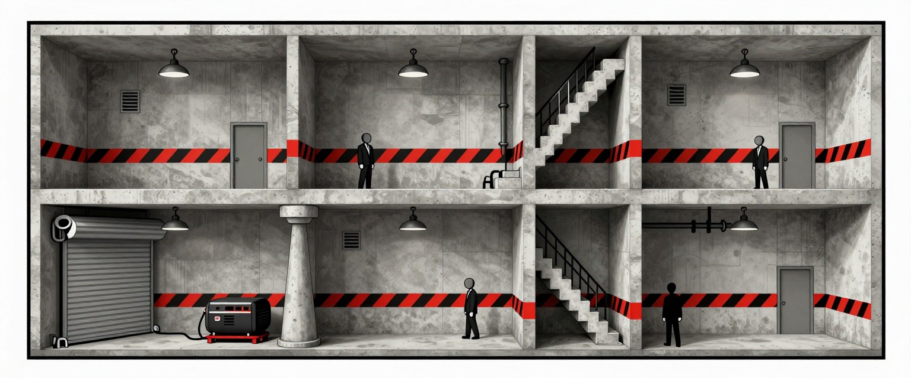
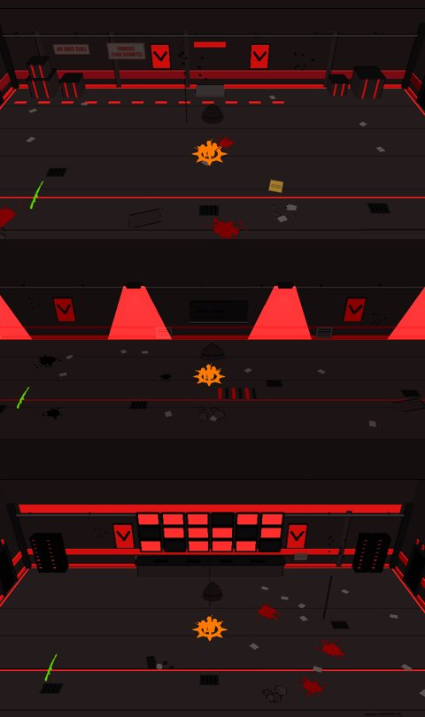
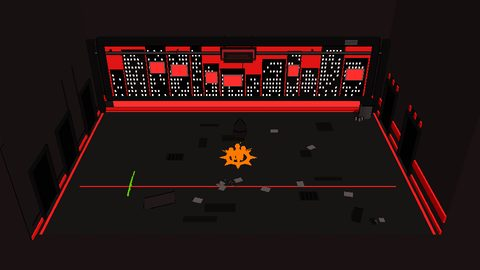
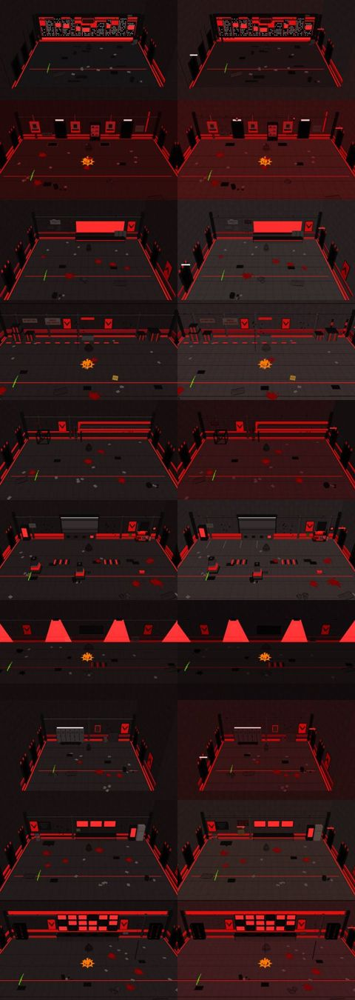
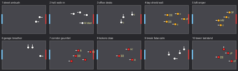
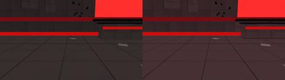
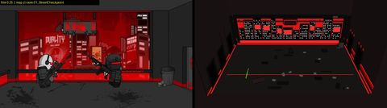

# Nexus Prominence (Hank Raid) Playground template

A Playground map for MADNESS: Project Nexus, built with [madnesswright](https://github.com/m4bwav/madnesswright), the open-source toolkit for modding the game; this repository was split out of it on 2026-11-11 with its full history. On the Steam Workshop: https://steamcommunity.com/sharedfiles/filedetails/?id=3837705778 Wiki: https://github.com/m4bwav/nexus-prominence/wiki

A Playground map template after the fan collab "NEXUS: HANK RAID | MADNESS COMBAT" (hosted by KJ and DUALITY, 2025): Hank storms the Nexus Prominence control tower from the street, room by room. The requester asked for "a template of this map". The video's art belongs to its animators, so this template copies none of it: it rebuilds the route as ten rooms with the game's own proxies and Nexus enemies, in the collab's gray-and-red look.

Status 2026-11-11 (newest): the camera reaches every corner (`FitCamera`; check with `NexusShots.Render -shotDir <dir> -corners`, which logs OK/OUT per corner) and rooms carry Madness dressing (`Gags`). **Run `python tools/make_decals.py <SceneTools>/Assets/Templates/NexusProminence/Tex` before Build**, or the signs and splats are skipped with a warning. Deployed, not played.

Earlier status 2026-11-11: rooms differ in size (`Width`/`Depth` per room in the table; the camera pans between the stretched borders), cover spreads through the floor (`CoverAt`), bigger squads, banners, stripes and floor details; render renders/rooms-2026-11-11c.jpg. Earlier status 2026-11-11: rooms rebuilt to look like the video (shared red-band shell plus a set per room, fog off); render check with `NexusShots.Render -shotDir <dir>`; see renders/. Earlier status: built 2026-11-10 in Unity 2019.2.6f1 (batch mode): the generator compiled first time and made all ten rooms; SYNCH VISUALS, scene-lint (0 errors), the .sobj (1.1 MB), check-mod and deploy all passed. **Not yet played.** Batch route: `Unity.exe -batchmode -quit -projectPath <SceneTools> -executeMethod NexusProminenceBuilder.Build`, then `NexusBatch.SyncAndBuild` (Editor/NexusBatch.cs: SYNCH VISUALS on room 1, save, compressed bundle build).

Encounters 2026-11-11 (`Encounters`, after `ChainDoors`; toggle `JuiceEncounters`): spawn-only doors (`PX_Door` of type `VentSide` or `Rapel`, linked to nothing) feed `Squad_Spawner` waves: room 4 a 3-agent rappel team (14 s), room 7 four agents from two vents (10 s), room 10 reinforcements, 5 agents, 2 riot guards, 2 soldats, squads of 3, at most 6 on screen, from a vent and two rappel lines (12 s). Spike strips (`PX_Togglable` type `Spikes` + `CustomAddon_ToggleAutomator`, up 90 frames, down 150) in room 6 (two, out of step) and room 7 (one), on hazard-striped plates. Colours warmed to the film's maroon cast. Not played: unknown whether the automator runs on a plain PX_Togglable (its header says custom togglable) and whether the game draws its own vent and rope.

Reinforcements 2026-11-14 (build zk, ten rounds round 1): the game lets a wave squad in only while the room's living enemies of that faction plus the next squad stay at or under the wave's `MaxUnitCount` (`Wave_Tandem.CanSpawnWithoutBreachingMax` in the decompiled game), so the old caps held the room 4 rappel team back until the room was empty. Toggle `ReinforceWhileFighting` raises the caps of the three waves to 5, 5 and 7. Toggle `DoorReinforcements` (`DoorWaves`, plan in `DoorWavePlan`) sends one squad of 2 to 4 through each room's spare doors (the sample room's doors that are not chained and allow spawning), sized to a saw-tooth curve with peaks in rooms 4, 7 and 10; rooms 1-3 send theirs only once the alarm is up (`SpawnRequirement MyFactionAlerted`). Not played. Render of rooms 4, 7 and 10 (look unchanged; the change is who walks in): renders/rooms-4-7-10-2026-11-14zk.jpg.

No Playground room 2026-11-14 (build zl, ten rounds round 2): room 1 used to keep the sample's `PX_Playground` proxy, which the game turns into the Playground control room (`Converter_Proxy.ReplaceProxy`), a white lab booth about 4 x 9 x 15 m whose window was masked through the street checkpoint's city skyline. A player called it "a playground room for no reason". Toggle `PlaygroundControlRoom` (off) leaves it out; the decompiled game shows the map does not need it (it is loaded from the Default Chamber's terminal, difficulty is global, the pause menu still leaves). Without it there is no in-map spawn or stage menu: set the difficulty in the Default Chamber before loading. Editor renders cannot show the booth (it exists only in game), so the room 1 render is the same as zk: renders/room-1-2026-11-14zl.jpg. Not played.

Each room its own place 2026-11-14 (build zn, ten rounds round 4): lighter mid-gray walls and floors as in the film (`LighterWalls`; light tiles from `tools/make_textures.py`), a light level that rises and falls along the raid with one landmark per room and lit headers over the way in and the way on (`RoomIdentity`; table `IdentityLight`). Landmarks are thin and high, so cover, fights and enemy counts are unchanged; camera, zoom and room sizes too. Not played.

Every room its own fight 2026-11-14 (build zp, ten rounds round 6): before, every room placed its enemies the same way, a loose group right of centre. Toggle `StagedFights` (tables `Posts` and `FilmCountFoes`) gives each room one idea from the film: 1 ambush (two guards, backs turned), 2 walk-in (a scout enters by a side door, `SpawnFromDoor`), 3 behind the desks, 4 shield wall (riot guards in front with `Defensive`), 5 sniper (a battle-rifle scout with `Camper`, which sends it to the loft's sniper points), 6 breather (unaware at the console), 7 gauntlet, 8 close quarters (`Hunter`), 9 false calm (unaware on break), 10 last stand (soldats holding the desks). Each enemy's place, facing, alertness, weapon and added behaviour are fields the game's own character marker reads (checked in the decompiled game). Rooms 6, 9 and 10 now start with 3, 4 and 4 placed enemies, inside the film count. No enemy starts nearer the way in than 45% of the room. Cover, camera, zoom and room sizes unchanged; markers do not render in editor shots, so the plan is drawn from the build log with `tools/fight_plan.py` (way in blue, way on red; white unaware, amber hunting, red combat; [ ] riot guard, c cover, D defensive, H hunter, R runner, S sniper camp, / sword, F battle rifle). Not played.

Care and finish 2026-11-14 (build zo, ten rounds round 5): the office counter, control tower desk, lockers, locker-room bench and cabinet are modelled props made in code (`ModelledProps`; `tools/make_props.py` writes OBJs in metres that import 1:1), at the size of the boxes they replace, so cover is unchanged. The controls office, sniper loft and locker room take a warmer, lighter grade from the film frames (`FilmGrade`: mauve office with a pale dado, brown loft with a red skirting line, locker room lit red from above). The Workshop text now says how the map was made; a new preview and gallery wait in the lab, not uploaded. Not played.

Drawn surfaces and a modelled crate 2026-11-14 (build zm, ten rounds round 3): walls, panels, floors and asphalt now wear tiling textures (outlined metal wall panels and floor slabs, generated with Z-Image through comfyui-gen, cropped to whole cells so they tile, tinted to the map's own colours by `tools/make_textures.py`; the full-size sources and recipe stay in the lab). UVs are set in metres (`TileMetres` 2.5) so a panel keeps one size on every box. The crate body is now a modelled crate with raised edge frames (made in code, imported as OBJ; the import came in at exactly 1.0 x 1.2 x 1.0, so OBJ in metres imports 1:1 into SceneTools). Toggles `TexturedSurfaces` and `HeroCrate`; false restores the zl look. Camera, zoom, room sizes and enemies unchanged. Not played.

Film framing: the shot renderer now has a film camera (`NexusShots.Render -filmcam -filmcams <file>`), placed per room from a hand-fitted list (low, close, level like the film) so the film-match pairs compare framing, not only the room. The editor-only view of the cargo bay from that camera:

Juice 2026-11-11: shootable set pieces from the film (room 2 display glass, room 7 lamps, room 10 monitor wall) via `Breakable` and `CustomObj_Destructible`; toggle `JuiceBreakables`; details and revert in [juice-changes.md](juice-changes.md). Not played yet.

## Rooms (left to right, each door chains to the next)

Sets per room are in the generator (`Street`, `WantedHall`, ...); the Workshop description carries the same table with difficulty. Stations and pickups come from `Stations` (fun pass 2026-11-11).

| # | Room | Enemies (Nexus) | Alert | Stations (back wall) | Floor pickup | Difficulty |
|---|------|-----------------|-------|----------------------|--------------|------------|
| 1 | Street checkpoint | 2 agents, rifles | unaware | Ammo | R_NN57 pistol | Easy |
| 2 | Wanted hall | 3 agents, 1 scout | unaware | - | M_SwordNexus | Easy |
| 3 | Controls office | 2 agents, 1 support | unaware | (ammo: no clear wall, skipped) | R_NM46 SMG | Easy |
| 4 | Cargo bay | 2 riot guards, 2 agents, 1 soldat | hunting | Med cabinet, grenade ammo | Shield_RiotLight | Hard |
| 5 | Sniper loft | 2 scouts (battle rifles), 2 agents | hunting | - | R_Hrifle_NFAL | Medium |
| 6 | Shutter garage | 2 engineers, 2 agents | hunting | Ammo | R_NZucker | Medium |
| 7 | Spotlight corridor | 4 agents, 1 riot guard | combat | Med cabinet, ammo | R_Nc762 rifle | Hard |
| 8 | Locker room | 1 riot guard, 2 agents | combat | - | M_SwordNexus | Medium |
| 9 | Break room | 3 agents, 1 support, 1 scientist | combat | Med cabinet | R_NS-V.10 | Hard |
| 10 | Control tower | 2 soldats, 2 riot guards, 1 engineer, 2 agents | combat | Med cabinet, ammo, grenade ammo | R_Hrifle_NFAL | Very hard |

Player start stays in room 1; the Playground control room is left out (toggle `PlaygroundControlRoom`). Weapons follow the film (`Loadout` in the generator, the game's own card names): rifles at the street checkpoint, pistols and SMGs in the hall, riot guards with `Shield_RiotLight` and a pistol, soldats with `R_Hrifle_NFAL`, scouts and a few later agents with `M_SwordNexus`; support, engineers and scientists keep their defaults. Wall signs and splats find a clear patch of wall (`CollectWallBusy`) or are dropped with a `no clear wall` log line. The Workshop preview comes from `tools/make_preview.py` over the room shots.

## Use it

1. Install Unity 2019.2.6f1 and open the SceneTools project (github.com/MPN-Modders/MPN_SceneTools); see the madnesswright-scenes skill.
2. Copy `Editor/NexusProminenceBuilder.cs` into `<SceneTools>/Assets/Editor/`.
3. Menu **Madness > Templates > Build Nexus Prominence _PG**. It writes `Assets/Scenes/NexusProminence_PG.unity` (asset label `nexusprominence`) and materials under `Assets/Templates/NexusProminence/`.
4. Select `Room_01_StreetCheckpoint`, press SYNCH VISUALS, look through each room, then `mpn.py scene-lint Assets/Scenes/NexusProminence_PG.unity`.
5. Madness > AssetBundle > Build, copy `nexusprominence.sobj` into `NexusProminence/` (the built .sobj is not kept in the repository, for size; the Workshop item 3837705778 carries it), then `mpn.py check-mod NexusProminence` and `mpn.py deploy NexusProminence`.
6. In game: enable the mod, open the Playground terminal, load Nexus Prominence.

## Playtest checklist

- Spawn in the street room; camera borders hold in every room.
- Every chained door leads to the next room and back; the spare doors still spawn.
- Red wall band sits at waist height on the back wall (the generator guesses its height; move it if not).
- Enemies path to every area; each room is clearable.
- `mpn.py log` shows no FAILED or ERROR line for the mod.

## Tweak

Rooms, cover and enemies are the `Rooms` table at the top of the generator; edit and re-run (it asks before overwriting).

Truer to the film 2026-11-14 (build zl, round 2, the requester's rule "don't betray the movie: the first room is only 2 enemies"): toggle `FilmTrueArrivals` keeps round 1's door backup only in the rooms where the film shows enemies walking in mid-fight (2 wanted hall, 4 cargo bay, 7 spotlight corridor, 10 control tower); the other rooms shut their spare doors (`DisableSpawn`), so the street checkpoint holds exactly its 2 agents. The film count per room is a standing table in ai-docs/plans/2026-11-14-ten-rounds-brief.md. Every round now pairs a film frame with the map render per room (lab script, reference only; no film art goes into the map). Small comparison, film frame left and the editor render of room 1 right: renders/film-vs-map-room-1-2026-11-14zl.jpg. Not played.

